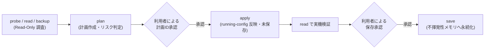

# Yamaha RTX / FWX120 Agent Skill

AIエージェント（Claude Code / OpenCode / Codex / Antigravity 等）に **YAMAHA RTX シリーズ / FWX120 ルータを安全かつ正確に操作させるための Agent Skill と専用 CLI ツール** です。

---

## 概要

多くの AI エージェントはネットワーク機器操作時に Cisco IOS の手順（`enable` / `configure terminal` / `write memory`）や UTF-8 前提の通信を推測してしまい、YAMAHA ルータでは構文エラー・文字化け・意図しない設定破壊を起こしがちです。

本リポジトリは、YAMAHA 固有の CLI セマンティクスを記述した Skill（`SKILL.md` / `references/yamaha-cli.md`）と、安全ガードレールを組み込んだ Python CLI（`scripts/rtx_agent.py`）を組み合わせることで、AI エージェントによる実機の状態調査・バックアップ・承認付き設定変更・保存を一貫した手順で実行できるようにします。

### 主な特徴

- **3 経路の共通インターフェース**: SSH（Netmiko `yamaha`）、Telnet（Netmiko `yamaha_telnet`）、USB / RS-232C シリアルコンソール（`pyserial`）を同じコマンド体系で操作可能。
- **Shift_JIS 既定対応＋文字化け検出停止**: YAMAHA 標準の Shift_JIS（`ja.sjis` / `sjis`）を既定とし、シリアルのマルチバイト分割や `en.ascii` / `ja.utf8` にも対応。デコード不良（`\ufffd`）を検出した場合は書き込み・保存を自動停止。
- **Read-Only の徹底**: Netmiko 接続時の `console lines infinity` 自動送信による意図しない running-config 変更を抑止し、ページング（`---more---` / `--- つづく ---`）をツール側で透過処理。
- **2 段階承認と安全ガードレール**:
  - 変更ワークフローは `probe` → `read` → `backup` → `plan` → **利用者承認** → `apply` → 実機検証 → **保存承認** → `save` を強制。
  - `show config` の `# Reporting Date:` を除外した正規化ハッシュで計画時・適用後・保存時のコンフィグドリフトを検知。
  - 危険コマンド（`save`, `restart`, `cold start`, `load`, `administrator`, `login`, `user attribute`, `sshd` 等）の直接投入をブロック。
  - 通信断リスクのある設定（IP・経路・フィルタ・NAT・VPN・`no` コマンド等）は `high_risk` 判定とし、シリアル復旧確認フラグ（`--serial-recovery-confirmed`）を要求。
  - `pp select N` / `tunnel select N` の解除忘れ（`none` 欠落）を `plan` 時に検出して拒否。
  - セッション終了時に未保存変更確認プロンプト `Save new configuration ? (Y/N)` が出た場合は常に `N` を応答し、無断保存を防止。
  - バックアップ・計画書・レシートはすべてパーミッション `0600` で保存し、出力プレビューでは秘密情報を自動マスク。



---

## 対象機種と動作環境

- **対象機種**: RTX810 / RTX830 / RTX840 / RTX1200 / RTX1210 / RTX1220 / RTX1300 / RTX3500 / RTX3510 / RTX5000 / FWX120
- **実機検証済み**: RTX830（Rev.15.02.33 / シリアルコンソール・Telnet）
  - 機種・ファームウェア Rev により対応コマンドや書式が異なるため、他機種への書き込み前は必ず公式コマンドリファレンスと `probe` / `backup` で確認してください。
- **必要環境**:
  - Python 3.10 以上
  - `netmiko>=4.5,<5`、`pyserial>=3.5,<4`
  - 操作対象ルータへ SSH / Telnet / シリアルで到達可能な実行ホスト

---

## ディレクトリ構成

```text
.
├── README.md                                  # 本ドキュメント
├── .gitignore
└── yamaha-rtx-agent-skill/                    # Agent Skill 本体ディレクトリ
    ├── SKILL.md                               # Skill 定義（手順・原則・制約）
    ├── README.md                              # Skill ディレクトリ単体向けガイド
    ├── references/
    │   └── yamaha-cli.md                      # YAMAHA CLI リファレンス（Cisco 差分・コマンド早見表）
    ├── scripts/
    │   └── rtx_agent.py                       # SSH / Telnet / Serial 操作 CLI
    ├── examples/
    │   └── change.txt                         # 変更コマンドファイル例
    ├── inventory.example.json                 # インベントリ設定テンプレート
    ├── requirements.txt                       # Python 依存パッケージ
    └── tests/                                 # ユニットテスト
        ├── test_rtx_agent.py
        └── test_transports.py
```

---

## 導入方法

### 1. リポジトリの取得と Python 環境構築

```bash
git clone https://github.com/MMX-Pentium/yamaha_rtx_skill.git
cd yamaha_rtx_skill/yamaha-rtx-agent-skill

python3 -m venv .venv
.venv/bin/pip install -r requirements.txt
```

### 2. 対象機器の登録（`inventory.json`）

テンプレートをコピーして接続先を記入します（`inventory.json` は `.gitignore` で除外されています）。**パスワードは `inventory.json` に記載しないでください。**

```bash
cp inventory.example.json inventory.json
```

設定例（`inventory.json`）:

```json
{
  "devices": {
    "rtx830-serial": {
      "transport": "serial",
      "port": "/dev/ttyUSB0",
      "baudrate": 9600,
      "username": "operator",
      "encoding": "shift_jis"
    },
    "rtx830-ssh": {
      "transport": "ssh",
      "host": "192.0.2.10",
      "port": 22,
      "username": "operator",
      "encoding": "shift_jis"
    },
    "rtx830-telnet": {
      "transport": "telnet",
      "host": "192.0.2.10",
      "port": 23,
      "username": "operator",
      "encoding": "shift_jis"
    }
  }
}
```

- **SSH 利用時**: 事前に別経路でホスト鍵の指紋を確認し、`~/.ssh/known_hosts` に登録してください（ホスト鍵検証は常に有効です）。
- **シリアル利用時**: Linux では実行ユーザーが `dialout` グループ等、シリアルデバイス（`/dev/ttyUSB0` 等）の読み書き権限を持つことを確認してください。
- **文字コード**: 標準（`ja.sjis` / `sjis` / `en.ascii`）は `"shift_jis"` のままで利用可能です。機器側を `ja.utf8` 等に変更している場合は `"utf-8"` に上書きしてください。

### 3. 認証情報の環境変数設定

ログインパスワード・管理者パスワードは実行時に環境変数で渡します（未設定機器は空文字可）。

```bash
export RTX_LOGIN_PASSWORD='<ログインパスワード>'
export RTX_ADMIN_PASSWORD='<administratorパスワード>'
```

### 4. AI エージェントへの Skill 導入

お使いの Agent Skills 対応クライアントのスキルディレクトリへ `yamaha-rtx-agent-skill/` を配置（またはシンボリックリンク）してください。

- **Claude Code（プロジェクト単位）**:
  ```bash
  mkdir -p .claude/skills
  ln -s /path/to/yamaha_rtx_skill/yamaha-rtx-agent-skill .claude/skills/yamaha-rtx-fwx-operator
  ```
- **OpenCode（プロジェクト単位）**:
  ```bash
  mkdir -p .opencode/skills
  ln -s /path/to/yamaha_rtx_skill/yamaha-rtx-agent-skill .opencode/skills/yamaha-rtx-fwx-operator
  ```
- **その他（Codex / Antigravity / 直接参照）**:
  - 各ツールのスキルディレクトリ（例: `.agents/skills/yamaha-rtx-fwx-operator`）へ配置するか、作業時に `yamaha-rtx-agent-skill/SKILL.md` と `yamaha-rtx-agent-skill/references/yamaha-cli.md` を参照させてください。

---

## 基本的な使い方（CLI ワークフロー）

`yamaha-rtx-agent-skill/` ディレクトリで実行します。

```bash
# 1. 疎通・機種・Rev・Security Class・文字化け有無を確認
.venv/bin/python scripts/rtx_agent.py --inventory inventory.json --device rtx830-serial probe

# 2. 状態確認（show 系コマンドのみ。管理者権限が必要なら --admin）
.venv/bin/python scripts/rtx_agent.py --inventory inventory.json --device rtx830-serial read 'show ip route'
.venv/bin/python scripts/rtx_agent.py --inventory inventory.json --device rtx830-serial read --admin 'show config list'

# 3. 変更前バックアップ（0600 権限で保存）
.venv/bin/python scripts/rtx_agent.py --inventory inventory.json --device rtx830-serial backup --output private/before.cfg

# 4. 変更計画の作成（plan_id・マスク済みコマンド・リスク判定が出力される）
.venv/bin/python scripts/rtx_agent.py --inventory inventory.json --device rtx830-serial plan --commands examples/change.txt --output private/change.plan.json

# 5. 利用者の明示承認後に適用（running-config のみ反映・未保存）
.venv/bin/python scripts/rtx_agent.py --inventory inventory.json --device rtx830-serial apply --plan private/change.plan.json --approve <plan_id>
# ※ high_risk=true の場合は、シリアル復旧経路を実確認した上で --serial-recovery-confirmed を付与

# 6. 適用後の検証・別途保存承認後に不揮発性メモリへ保存
.venv/bin/python scripts/rtx_agent.py --inventory inventory.json --device rtx830-serial save --receipt private/change.plan.receipt.json --approve <plan_id>
```

---

## テストの実行

実機なしで実行できるユニットテストを同梱しています。

```bash
cd yamaha-rtx-agent-skill
python3 -m unittest discover -s tests -v
```

---

## セキュリティ・運用上の注意

- **Telnet は平文通信**です。認証情報やコンフィグが暗号化されないため、隔離された管理ネットワークや検証環境でのみ利用してください。
- **`show config` には秘密情報が含まれます**。`private/` に保存したバックアップや計画ファイルの中身をチャット・Issue・ログに貼り付けないでください。
- **`apply` は非トランザクション**です。途中コマンドでエラーが発生した場合は即中断しますが、先行コマンドの変更は running-config に残ります。自動ロールバック機能はないため、通信断リスクのある変更前は必ずシリアル復旧手段を確保してください。
- `console character` / `console lines` 等の一部コンソール設定は未保存のまま切断すると元に戻る実機仕様があるため、`apply` → `save` を別セッションで実行すると差分検知により停止する場合があります。

---

## 免責事項

- 本プロジェクトは非公式のオープンソースツール・スキルです。ヤマハ株式会社とは関係ありません。
- YAMAHA、RTX、FWX はヤマハ株式会社の登録商標です。
- 本番機器への適用は必ず検証環境での試験とバックアップ取得のうえ、利用者の責任において実施してください。
